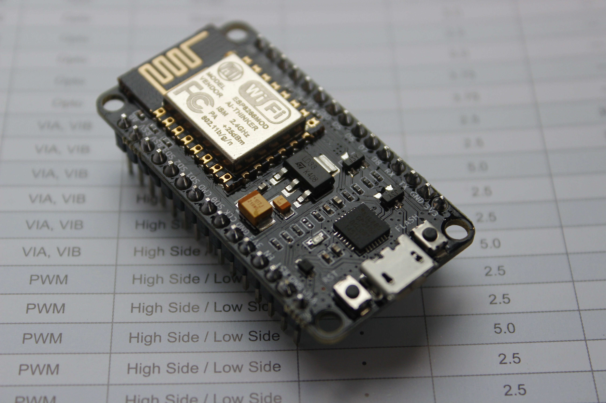
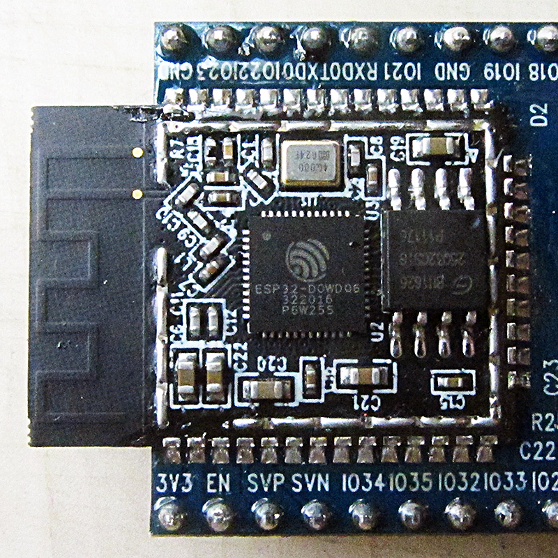

# Felino Arduino Workspace

Workspace pengembangan Arduino Framework untuk ESP8266 dan ESP32 dengan dokumentasi hardware, pemetaan GPIO, serta template yang dapat digunakan ulang.

## Status

Phase 1 — fondasi workspace dan dokumentasi hardware. Lihat [phase1.md](./phase1.md) untuk PRD dan kriteria penerimaan.

## Struktur saat ini

```text
.
├── README.md
├── phase1.md
├── prompt.md
├── doc/       # Datasheet dan dokumen referensi hardware
└── img/       # Foto board dan diagram pinout ESP32
```

## Profil hardware awal

- **ESP8266:** NodeMCU ESP-12E dengan OLED SSD1306 eksternal I2C.
- **ESP32:** ESP32 DevKit V1 dengan OLED SSD1306 eksternal I2C. DevKit V1 sering berupa klon; cocokkan pinout dan revisi dengan board fisik.
- **Pin I2C default:** NodeMCU SDA = D2/GPIO4, SCL = D1/GPIO5; ESP32 DevKit SDA = GPIO21, SCL = GPIO22. Jangan menerapkan pin satu board ke board lainnya.

Lihat [prompt.md](./prompt.md) untuk instruksi AI yang dapat digunakan ulang saat membuat proyek berdasarkan profil hardware tersebut. Daftar sumber datasheet ada di [doc/SOURCES.md](./doc/SOURCES.md), dan kredit/lisensi aset gambar ada di [img/SOURCES.md](./img/SOURCES.md).

Halaman referensi board untuk browser: [doc/index.html](./doc/index.html). GitHub Pages dideploy otomatis dari folder `doc/` beserta aset `img/` saat perubahan ke `main`.

## Gambar board





Diagram pinout [ESP32 DevKit V1](./img/ESP32-DevKit-pinout.png) tersedia terpisah. Cocokkan semua gambar dan pinout dengan revisi board fisik sebelum wiring.

## Catatan keselamatan dan akurasi

Pastikan spesifikasi OLED, alamat I2C, tegangan modul, serta revisi board dari label dan datasheet perangkat yang benar-benar digunakan. File ESP32-DevKitC dalam `doc/` adalah referensi board resmi Espressif, bukan datasheet untuk semua klon ESP32 DevKit V1.
